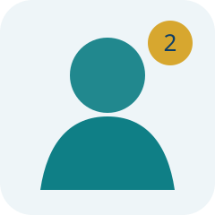

# هیئت مدیره

 

### محمد ایرانی
رئیس هیئت مدیره 

حوزه: راهبری، سیاست‌گذاری و تعاملات نهادی.

[صفحه شخصی نمونه](profiles/board-member-1.md){ .md-button }

### عباس راد
نایب‌رئیس 

حوزه: مالی، قراردادها و گزارش‌دهی.

[صفحه شخصی نمونه](profiles/board-member-2.md){ .md-button }

### مرتضی ذاکری
منشی 

حوزه: امور اعضا و ارتباطات دانشگاهی.
 

[صفحه شخصی نمونه](profiles/board-member-3.md){ .md-button }

### علی عسکری
عضو اصلی 

حوزه : معماری و مدیریت ریسک.

### جلال الدین فرجی
عضو اصلی  
حوزه : برنامه‌ریزی پروژه، ساخت و کنترل کیفیت.

## وظایف عمومی
نمونه وظایف شامل اجرای مصوبات مجامع، تصویب برنامه‌های اجرایی در حدود اختیارات قانونی، نظارت بر مدیرعامل، بررسی قراردادهای مهم و ارائه گزارش منظم به اعضا است.
